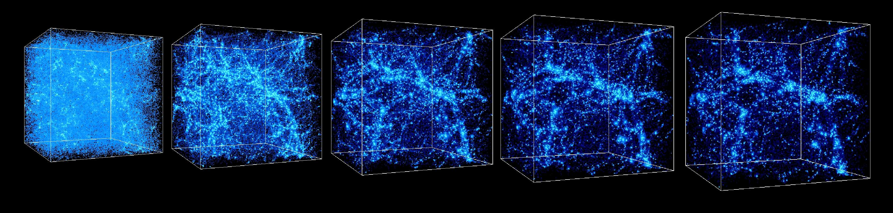

<!-- PROJECT LOGO -->
<br />
<div align="center">
    
</div>

<h1 align="center">Space - CoE</h1>

<!-- TABLE OF CONTENTS -->
<details>
  <summary>Table of Contents</summary>
  <ol>
    <li><a href="#Overview">Overview of the project</a></li>
    <li><a href="#References">References</a></li>
    <li><a href="#Architecture">Architecture</a></li>
    <li>
      <a href="#Launch">Launch</a>
      <ul>
        <li><a href="### MN5">Run mn5</a></li>
        <li><a href="### Local">Run local</a></li>
      </ul>
    </li>
  </ol>
</details>

## Overview

More on this coming...

## References

For a paper on the image-to-image conversion task: https://gitlab.hpai.bsc.es/hpai-core/space-coe/uploads/c714c27539a8bebaf1df3c067c21c1e0/U_net_ICL.pdf

The wiki of the Space-CoE project (request access to guillermo.marin@bsc.es): https://www.space-coe.eu/wiki


## Architecture

More on this coming...


## Launch

### MN5

```
LAUNCH_MN5_ACC <sbatch launch_train.sh> mn5 test attention U-Net
```

### Local

```
python src/train.py commit_tag=1 paths=local trainer=cpu logger=csv
```
