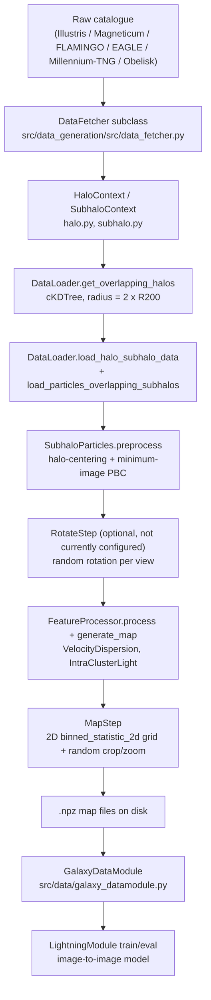

# End-to-end data flow: raw simulation → training maps

## Stage detail

- **Fetch** — a `DataFetcher` subclass (one per simulation family) reads halo/subhalo catalogue tables and, on demand, particle data, via simulation-specific readers (`g3read` for Magneticum, `h5py` for EAGLE/Obelisk, `illustris_python`/`swiftsimio` for the TNG family/FLAMINGO). Units are converted per-field via `apply_unit_conversion`/`apply_conversion` (`data_fetcher.py:354-395`, `utils.py:788-797`), evaluating each catalogue YAML's `scaling` string. Rows are filtered via `apply_filters` (`data_fetcher.py:267-349`) against YAML filter expressions. See [Data fetchers: shared mechanics](../02-data-generation-pipeline/01-shared-mechanics.md).

- **Context objects** — `HaloContext`/`SubhaloContext` wrap the filtered tables; catalogue-native field names are renamed via each config's `column_map` (e.g. `Group_R_Crit200` → `r200`).

- **Neighbour/overlap detection** — `DataLoader.get_overlapping_halos` builds a `cKDTree` over all subhalo positions and, per halo, finds subhalos from *other* halos within `2×R200`. See [Neighbour search](../02-data-generation-pipeline/07-neighbour-search.md).

- **Particle loading + PBC correction** — for the halo's own subhalos and any overlapping ones, particle data is fetched and `SubhaloParticles.preprocess` centres positions on `halo.gpos` and applies minimum-image PBC. See [Periodic boundary correction](../02-data-generation-pipeline/08-periodic-boundary-correction.md) — including a real, unresolved coordinate-frame gap in how overlapping particles get combined with the halo's own.

- **Rotation (optional)** — `RotateStep` applies `utils.rotate`, producing multiple views per halo. See [Rotation](../02-data-generation-pipeline/09-rotation.md) — not currently applied to any dataset, since no config supplies the parameters it needs.

- **Feature computation** — `FeatureProcessorFactory` dispatches to `VelocityDispersionProcessor`/`ICLProcessor`, which compute per-particle values later aggregated into 2D maps. See [ICL/BCG classification](../02-data-generation-pipeline/10-icl-bcg-classification.md).

- **Map generation** — `MapStep._create_maps` bins particles onto (up to) 3 orthogonal projections via `scipy.stats.binned_statistic_2d`; field of view and pixel scale as described in [Map generation](../02-data-generation-pipeline/12-map-generation.md). `_create_n_zooms` writes randomly-cropped `.npz` files (feature-map channel + interloper-mask channel).

- **Training input** — `GalaxyDataModule` (`src/data/galaxy_datamodule.py`) loads `(image, label)` pairs. Which feature is which is set per-dataset in `configs/data/*.yaml`, not hardcoded in the datamodule itself — e.g. `configs/data/combined_dataset.yaml` (the active default, per `configs/train.yaml`'s `data: combined_dataset`) sets `data_dir` to `VelocityDispersion` folders and `target_maskdir` to `IntraClusterLight` folders, with `mask_interlopers: True`. Every `LightningModule` trains to predict the ICL map from the velocity-dispersion map.

## See also

- [Entry points](02-entry-points.md) for how this whole chain gets kicked off.
- [Core abstractions](04-core-abstractions.md) for the `DataFetcher`/`PipelineStep` design this flow relies on.

---
*Sourced from the SPACE-COE Technical Map §2. The final stage's citation was corrected this session: the technical map pointed at `galaxy_datamodule.py:202,306-309`, but those lines are generic image/label plumbing — the actual VelocityDispersion→image, IntraClusterLight→label mapping is set in `configs/data/*.yaml`, verified directly this session.*
